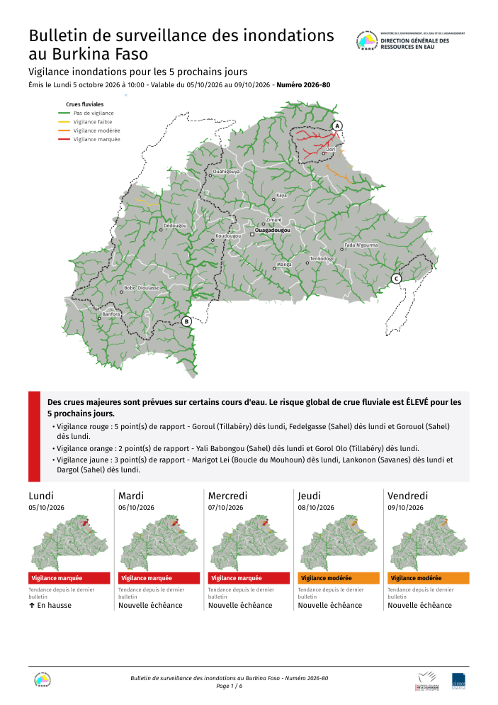
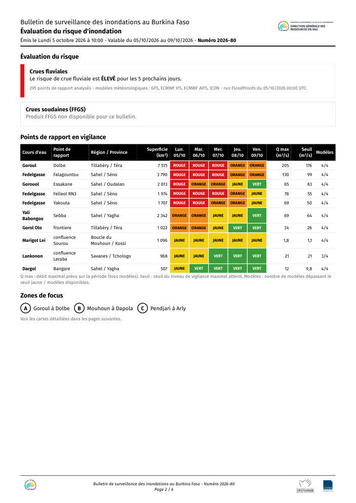
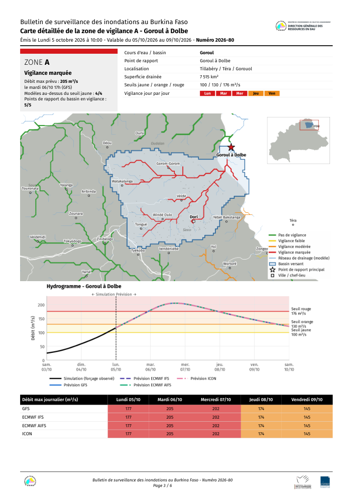
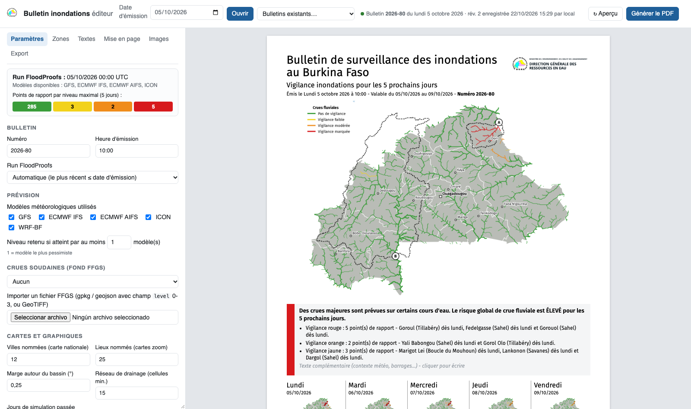

# Bulletin de surveillance des inondations - Burkina Faso

Outil de production du **bulletin bi-hebdomadaire (lundi et jeudi) de vigilance inondations** de la
Direction Générale des Ressources en Eau (DGRE) du Burkina Faso, à partir des prévisions de débit de la
chaîne **FloodProofs** (Fondation CIMA). La mise en page s'inspire du *Flood Guidance Statement*
britannique.

Deux façons de produire le bulletin :

* **en ligne de commande** (`make_bulletin.py`) : bulletin entièrement automatique, PDF + HTML + CSV,
  planifiable par `cron` ;
* **avec l'application web** (`webapp/`) : l'outil propose le bulletin automatique et le prévisionniste
  l'ajuste (zones de focus, textes, mise en page, images…) avant de générer le PDF, à plusieurs si besoin.

<p align="center">
  
  
  
</p>
<p align="center"></p>

## Contenu du bulletin

| Page | Contenu |
|------|---------|
| 1 | Carte nationale de la vigilance **maximale sur 5 jours** (cours d'eau colorés vert / jaune / orange / rouge selon le dépassement des seuils d'alerte, d'alarme et d'urgence de chaque point de rapport), message de synthèse, 5 cartes journalières avec la tendance depuis le bulletin précédent. Fond FFGS (crues soudaines) en option. |
| 2 | Évaluation du risque (crues fluviales, crues soudaines), tableau des points de rapport en vigilance (niveau par jour, débit max, seuil, nombre de modèles), liste des zones de focus. |
| 3+ | Une page par **zone de focus** (aucune par défaut) : fiche de risque, carte du bassin versant (délimité depuis le réseau de drainage du modèle, villes et villages, provinces, carte de situation), hydrogramme (simulation passée + prévision de chaque modèle météorologique, seuils), tableau journalier par modèle, jusqu'à 2 hydrogrammes complémentaires. |
| dernière | Guide de lecture : niveaux et impacts, méthode, prochain bulletin, contact. |

## Démarrage rapide

```bash
git clone https://github.com/malcobak/bfa-flood-bulletin.git
cd bfa-flood-bulletin
python3 -m venv .venv && .venv/bin/pip install -r requirements.txt   # + bibliothèques système : voir docs/installation.md
.venv/bin/python make_bulletin.py --date 2026-10-05 --focus Goroul_Dolbe   # bulletin d'exemple -> output/bulletin_20261005/
./run_webapp.sh                                                          # application web : http://127.0.0.1:8000
```

Le dépôt contient toutes les données nécessaires pour essayer l'outil : couches statiques du modèle,
fonds cartographiques et deux runs FloodProofs d'exemple (1er et 5 octobre 2026).

## Documentation

| Document | Pour qui | Contenu |
|----------|----------|---------|
| [docs/installation.md](docs/installation.md) | administrateur | Installation sur un serveur Linux ou macOS : bibliothèques, données, récupération des sorties FloodProofs, service web, accès à distance, sauvegardes, mise à jour, dépannage. |
| [docs/utilisation.md](docs/utilisation.md) | prévisionniste | Ligne de commande et guide de l'application web, onglet par onglet. |
| [docs/configuration.md](docs/configuration.md) | administrateur | Référence de `config.yaml`, `config.local.yaml`, `focus_stations.yaml`, `notes_template.yaml`, calcul des niveaux. |
| [docs/architecture.md](docs/architecture.md) | développeur | Modules et fonctions, format des données, brouillon JSON, cache des figures, API web. |

## Structure du dépôt

```
make_bulletin.py            ligne de commande
config.yaml                 configuration générale (versionnée)
config.local.example.yaml   modèle des réglages propres à une installation (-> config.local.yaml, non versionné)
focus_stations.yaml         zones de focus par défaut et sélection automatique
notes_template.yaml         modèle de texte du prévisionniste (ligne de commande)
requirements.txt            dépendances Python
run_webapp.sh               lancement de l'application web
bfa_bulletin/               moteur : lecture FloodProofs, niveaux, cartes, hydrogrammes, textes, HTML/PDF
  templates/                gabarit HTML (Jinja2) et feuille de style du bulletin
webapp/                     application web (FastAPI + interface HTML/JS sans compilation)
  deploy/                   service systemd (Linux), launchd (macOS), exemple de crontab
assets/                     logos (DGRE, AICS, CIMA) et polices Fira Sans (licence OFL)
data/static/                couches statiques FloodProofs/Continuum du domaine BFA
data/geo/                   fonds cartographiques (Natural Earth, GeoNames, geoBoundaries)
data/example_run/           deux runs FloodProofs d'exemple
docs/                       documentation
output/                     bulletins produits (non versionné)
cache/                      polygones des bassins versants calculés (non versionné)
```

## Licence

Le code est distribué sous licence **GNU GPL v3** (voir [LICENSE](LICENSE)) : il peut être utilisé, modifié
et redistribué, à condition que les versions modifiées redistribuées restent sous la même licence et
publient leur code source. Les données, polices et logos inclus gardent leurs propres conditions
(ci-dessous).

## Données incluses et licences

| Données | Source | Licence / remarque |
|---------|--------|--------------------|
| `data/static/` : points de rapport, réseau hydrographique, directions de drainage (PNT), aires drainées | Chaîne FloodProofs du Burkina Faso (DGRE / Fondation CIMA) | Données du projet ; citer la DGRE et la Fondation CIMA. |
| `data/example_run/` : hydrogrammes prévus de 295 points de rapport, runs du 01/10 et 05/10/2026 | FloodProofs (Fondation CIMA) | Exemples pour tester l'outil, pas des prévisions officielles. |
| `data/geo/` : frontières, régions, lacs | Natural Earth | Domaine public |
| `data/geo/places.gpkg` : villes et villages | GeoNames | CC-BY 4.0 |
| `data/geo/provinces.gpkg` : provinces | geoBoundaries | CC-BY 4.0 |
| `assets/fonts/` : Fira Sans | Mozilla / Carrois | SIL Open Font License (`assets/fonts/OFL.txt`) |
| `assets/logos/` | DGRE, AICS, Fondation CIMA | Logos des institutions, utilisés uniquement dans le bulletin. |

## Crédits

Bulletin de la **DGRE** (Burkina Faso), prévisions **FloodProofs** de la **Fondation CIMA**, avec le soutien
de l'**AICS** (Agence italienne pour la coopération au développement).
